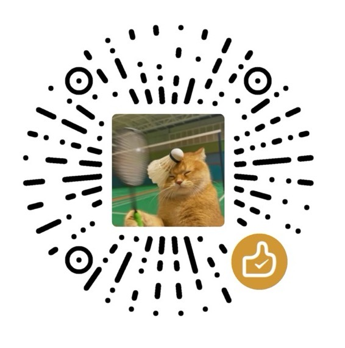

# Ophel Atlas 🚀

> Machen Sie AI-Chats zu Dokumenten, die Sie lesen, navigieren und wiederverwenden können

<div align="center">
  

  <h3 style="margin-top: -2px;">✨ Machen Sie aus Gesprächen Wissen, nicht nur Geschichte ✨</h3>
  
  <p>
    Schluss mit dem Verlieren im endlosen Scrollen. Klären Sie den Kontext mit Echtzeit-Gliederungen, bauen Sie Ihr System mit Gesprächsordnern auf, verfeinern Sie die Erfahrung mit der Prompt-Bibliothek und lassen Sie funkelnde Gedanken in geordneten Bahnen fließen.
  </p>
  
  <p align="center" style="font-size: 12px; color: #555;">👇 Demo: Von "Unendlichem Scrollen" zu "Navigierbaren AI-Dokumenten"</p>


  <p>
    <strong><em>Macht den AI-Chat zum ersten Mal zu einem wirklich organisierbaren Workflow</em></strong><br/>
  </p>

  <small style="opacity: 0.6;">
  Egal welche Plattform Sie nutzen, Ophel ermöglicht es Ihnen, Gespräche in wiederverwendbare Workflows mit einer konsistenten, einheitlichen Erfahrung zu organisieren.
  </small>
  <p>
    <a href="https://chatgpt.com"></a>
    <a href="https://gemini.google.com"></a>
    <a href="https://claude.ai"></a>
    <a href="https://aistudio.google.com"></a>
    <a href="https://business.gemini.google/"></a>
    <a href="https://grok.com"></a>
    <br/>
    <a href="https://www.doubao.com"></a>
    <a href="https://chat.deepseek.com"></a>
    <a href="https://www.kimi.com"></a>
    <a href="https://chat.z.ai"></a>
    <a href="https://chatglm.cn/main/alltoolsdetail?lang=zh"></a>
    <a href="https://www.qianwen.com"></a>
    <a href="https://chat.qwen.ai"></a>
    <a href="https://yuanbao.tencent.com"></a>
    <a href="https://ima.qq.com"></a>
    <br />
    <a href="https://ophel.app/docs/enhancements/site-extensions"></a>
    <br/>
    
    <a href="../../LICENSE"></a>
    
    <a href="https://github.com/urzeye/ophel/stargazers"></a>
    <a href="https://github.com/urzeye/ophel/network/members"></a>
    <br />
    <a href="https://chromewebstore.google.com/detail/ai-chat-organizer-outline/lpcohdfbomkgepfladogodgeoppclakd"></a>
    <a href="https://microsoftedge.microsoft.com/addons/detail/ophel-atlas-ai-chat-navi/ffpenkdeifijngifjmbbpijfpdhlolga"></a>
    <a href="https://addons.mozilla.org/firefox/addon/ophel-ai-chat-enhancer/"></a>
    <a href="https://greasyfork.org/scripts/563646-ophel-ai-chat-page-enhancer"></a>
    <a href="https://scriptcat.org/script-show-page/6519"></a>
  </p>

</div>

<!-- Promo Link -->
<p align="center">
  📣 <a href="https://github.com/urzeye/ophel/issues/30">
    <strong>Help promote Ophel Atlas</strong>
  </a>
</p>

<p align="center">
  <a href="#-kernfunktionen">Kernfunktionen</a> •
  <a href="#-schnellstart">Schnellstart</a> •
  <a href="#-ophel-atlas-unterstützen">Ophel Atlas unterstützen</a> •
  <a href="#-mitmachen">Mitmachen</a>
</p>

<p align="center">
  🌐 <a href="../../README.md">English</a> | <a href="../../README_zh-CN.md">简体中文</a> | <a href="./README_zh-TW.md">繁體中文</a> | <a href="./README_ja.md">日本語</a> | <a href="./README_ko.md">한국어</a> | <strong>Deutsch</strong> | <a href="./README_fr.md">Français</a> | <a href="./README_es.md">Español</a> | <a href="./README_pt-BR.md">Português</a> | <a href="./README_ru.md">Русский</a>
</p>

## ✨ Kernfunktionen

> Ideal für Lernen, Forschung, Anforderungsanalyse, Code-Diskussionen, Content-Erstellung — jede KI-Konversation, die Struktur, Ordnung und Wiederverwendung braucht.

<table>
  <thead>
    <tr>
      <th width="200">Funktion</th>
      <th>Beschreibung</th>
    </tr>
  </thead>
  <tbody>
    <tr>
      <td>🧭 <a href="https://ophel.app/docs/features/outline">Smart Outline</a></td>
      <td>Automatische Analyse der Gesprächsstruktur in ein navigierbares Inhaltsverzeichnis mit Ebenen-Faltung, Suche, Ankern, Lesezeichen, Gliederung kopieren und Wortzählung</td>
    </tr>
    <tr>
      <td>💬 <a href="https://ophel.app/docs/features/conversations">Konversationen</a></td>
      <td>Ordner + Tags für zweidimensionale Verwaltung, automatische Synchronisierung, Suche, Stapeloperationen und Drag-and-Drop-Sortierung</td>
    </tr>
    <tr>
      <td>📤 <a href="https://ophel.app/docs/features/export">Export</a></td>
      <td>Multi-Format-Export (Markdown/JSON/TXT), Zip-Pakete mit Bildern und Anhängen, segmentierter Export für präzise Inhaltsextraktion</td>
    </tr>
    <tr>
      <td>💡 <a href="https://ophel.app/docs/features/prompts">Prompt-Bibliothek</a></td>
      <td>Variablen-Templates, Kategorisierung, Ein-Klick-Einfügung, Prompt-Chains und Warteschlange für automatisches sequenzielles Senden, Auswahl-Zitat-Aktionen</td>
    </tr>
    <tr>
      <td>🧩 <a href="https://ophel.app/docs/enhancements/site-extensions">Website-Adapter</a></td>
      <td>Integrierte Adapter für 15 gängige KI-Websites; im Bereich „Website-Pakete“ lassen sich Adapter-Pakete online installieren, um <strong>per Hot-Swap weitere Websites zu unterstützen</strong>; Änderungen an integrierten Websites werden per Cloud-Update automatisch repariert</td>
    </tr>
    <tr>
      <td>🔍 <a href="https://ophel.app/docs/features/global-search">Globale Suche</a></td>
      <td>Einheitliche Suche über Konversationen, Outlines, Prompts und Einstellungen mit <code>folder:</code> <code>tag:</code> <code>date:</code> Syntax-Filtern und Fuzzy-Matching</td>
    </tr>
    <tr>
      <td>📖 <a href="https://ophel.app/docs/enhancements/content">Leseerlebnis</a></td>
      <td>Mermaid-Diagramm-Rendering, LaTeX-Formel-Support, Markdown-Formatierung für Nutzerfragen, Scroll-Sperre</td>
    </tr>
    <tr>
      <td>⌨️ <a href="https://ophel.app/docs/customization/shortcuts">Produktivität</a></td>
      <td>Lesefortschritt wiederherstellen, benutzerdefinierte Shortcuts, Modellsperre, erweiterte Tab-Benennung, KI-Fertigmeldung</td>
    </tr>
    <tr>
      <td>🎨 <a href="https://ophel.app/docs/customization/appearance">Themes</a></td>
      <td>20+ Themes, benutzerdefiniertes CSS, Widescreen-Modus, Zen-Modus, <code>Option+D</code> für Dark/Light-Wechsel</td>
    </tr>
    <tr>
      <td>🔒 <a href="https://ophel.app/docs/data/privacy">Datenschutz & Daten</a></td>
      <td>Standardmäßig lokale Speicherung, WebDAV Multi-Geräte-Sync, Datei-Import/Export, keine Datenerhebung</td>
    </tr>
  </tbody>
</table>

<p align="right"><a href="https://ophel.app/docs/introduction">📖 Vollständige Dokumentation →</a></p>

> [!IMPORTANT]
>
> **Ophel Atlas** stellt Datenschutz an erste Stelle: Standardmäßig lokal gespeichert, deine Daten bleiben unter deiner Kontrolle.
>
> - **Standardmäßig lokal gespeichert:** Einstellungen, Prompts und Gesprächsverwaltung liegen im Browser
> - **Kein Konto erforderlich:** Nutzung ohne Registrierung
> - **Berechtigungen nach Bedarf:** optionale Berechtigungen nur bei Bedarf, jederzeit widerrufbar (siehe Permissions-Seite in der Erweiterung)
> - **Optionaler WebDAV-Sync:** Multi-Device-Sync über deinen eigenen WebDAV-Server (kontrollierbar, portabel)
> - **Export & Backup:** Export und Migration, kein Lock-in
>
> _Hinweis: Die Unterstützung einzelner KI-Websites hängt vom Site-Matching und von Änderungen der Seitenstruktur ab._

## 🚀 Schnellstart

> [!tip]
>
> **Wir empfehlen dringend die Verwendung der Browser-Erweiterungsversion** für einen vollständigeren Funktionsumfang, eine bessere Erfahrung und höhere Kompatibilität. Die Userscript-Version hat Einschränkungen.

### Web Store

<a href="https://chromewebstore.google.com/detail/ai-chat-organizer-outline/lpcohdfbomkgepfladogodgeoppclakd"></a>
<a href="https://microsoftedge.microsoft.com/addons/detail/ophel-atlas-ai-chat-navi/ffpenkdeifijngifjmbbpijfpdhlolga"></a>
<a href="https://addons.mozilla.org/firefox/addon/ophel-ai-chat-enhancer/"></a>
<a href="https://greasyfork.org/scripts/563646-ophel-ai-chat-page-enhancer"></a>
<a href="https://scriptcat.org/script-show-page/6519"></a>

<details>
<summary><strong>Manuelle Installation (Offline oder eingeschränkter Zugriff)</strong></summary>


#### Browser Erweiterung

1. Laden Sie das Installationspaket von [Releases](https://github.com/urzeye/ophel/releases/latest) herunter und entpacken Sie es
2. Öffnen Sie die Seite zur Verwaltung von Browsererweiterungen und aktivieren Sie den **Entwicklermodus**
3. Klicken Sie auf **Entpackte Erweiterung laden** und wählen Sie den entpackten Ordner aus

#### Userscript

1. Installieren Sie [Tampermonkey](https://www.tampermonkey.net/)
2. Laden Sie die `.user.js` Datei von [Releases](https://github.com/urzeye/ophel/releases) herunter
3. Ziehen Sie sie in den Browser oder klicken Sie auf den Link zur Installation


</details>

## 🙌 Ophel Atlas unterstützen

<!-- supporters:start -->

<!-- This block is auto-generated by `pnpm supporters:sync`. Do not edit manually. -->

### 💖 Besonderer Dank

<p align="center">
  <a href="https://github.com/treasuresure">
    <br />
    <sub><b>treasuresure</b></sub>
  </a>
</p>

### 🌟 Unterstützer

<table align="center">
  <tbody>
  <tr>
    <td align="center" valign="top" width="14.28%">
      <br />
      <sub><b>Hugh</b></sub>
    </td>
    <td align="center" valign="top" width="14.28%">
      <br />
      <sub><b>**南</b></sub>
    </td>
    <td align="center" valign="top" width="14.28%">
      <br />
      <sub><b>anonymous</b></sub>
    </td>
    <td align="center" valign="top" width="14.28%">
      <br />
      <sub><b>狷客行舟🍜狂？</b></sub>
    </td>
    <td align="center" valign="top" width="14.28%">
      <br />
      <sub><b>**煜</b></sub>
    </td>
    <td align="center" valign="top" width="14.28%">
      <a href="https://github.com/Ice-wilderness">
        <br />
        <sub><b>Ice_wilderness</b></sub>
      </a>
    </td>
    <td align="center" valign="top" width="14.28%">
      <a href="https://github.com/t0ny-peng">
        <br />
        <sub><b>Jeff Peng</b></sub>
      </a>
    </td>
  </tr>
  <tr>
    <td align="center" valign="top" width="14.28%">
      <br />
      <sub><b> 火华兰樱</b></sub>
    </td>
    <td align="center" valign="top" width="14.28%">
      <br />
      <sub><b>Lewu Gao</b></sub>
    </td>
    <td align="center" valign="top" width="14.28%">
      <br />
      <sub><b>Will</b></sub>
    </td>
    <td align="center" valign="top" width="14.28%">
      <br />
      <sub><b>Steel Maestro</b></sub>
    </td>
    <td align="center" valign="top" width="14.28%">
      <br />
      <sub><b>Count Basil</b></sub>
    </td>
    <td align="center" valign="top" width="14.28%">
      <br />
      <sub><b>anonymous</b></sub>
    </td>
    <td align="center" valign="top" width="14.28%">
      <br />
      <sub><b>**然</b></sub>
    </td>
  </tr>
  </tbody>
</table>

<!-- supporters:end -->

---

<p align="center">
  <em>Wenn <strong>Ophel Atlas</strong> Freude in deinen Arbeitsfluss gebracht oder dir wertvolle Zeit gespart hat, würden wir uns über eine <strong>Star</strong> oder ein <strong>Sponsor</strong> sehr freuen.</em> ☕️
</p>

<p align="center">
  <strong>Teilen ist ebenso wertvoll:</strong> Wir würden uns freuen, wenn du deine Erfahrungen auf <strong>Reddit, X, YouTube, <a href="https://linux.do/">Linux.do</a> oder <a href="https://meta.appinn.net">Appinn</a></strong> teilst. Jedes Feedback und jede Empfehlung helfen Ophel zu wachsen!
</p>

<p align="center">
  <a href="https://ko-fi.com/urzeye">
    
  </a>
</p>


<table align="center" border="0" cellpadding="16" cellspacing="0">
  <tr>
    <td align="center">
      <br />
      <sub><b>WeChat Pay</b></sub>
    </td>
    <td align="center">
      <br />
      <sub><b>Alipay</b></sub>
    </td>
    <td align="center">
      <a href="https://afdian.com/a/urzeye">
        <picture>
          <source media="(prefers-color-scheme: dark)" srcset="https://afdian-connect.vercel.app/profile.svg?slug=urzeye&bg_color=%230d1117&text_color=%23dedbd7&border_color=%232e343d" />
          <source media="(prefers-color-scheme: light)" srcset="https://afdian-connect.vercel.app/profile.svg?slug=urzeye" />
          
        </picture>
      </a><br />
      <sub><b>Afdian</b></sub>
    </td>
  </tr>
</table>

## 🤝 Mitmachen

<p align="center">
  <em>„Wenn du schnell gehen willst, geh allein. Wenn du weit gehen willst, geh gemeinsam."</em>
</p>

<p align="center">
  Vielen Dank an die <a href="https://linux.do/">Linux.do</a>-Community für die Diskussionen und Unterstützung. Viele Ideen und Verbesserungen in diesem Projekt stammen aus dem enthusiastischen Feedback der Community.<br>
  Wir freuen uns auf weitere Entwickler, die sich uns anschließen. Wenn Sie mit der Codebasis nicht vertraut sind, nutzen Sie die Entwicklerdokumentation oder KI-Assistenten für einen schnellen Einstieg:
</p>

<p align="center">
  <a href="https://ophel.app/docs"></a>
  &nbsp;
  <a href="https://deepwiki.com/urzeye/ophel"></a>
  &nbsp;
  <a href="https://zread.ai/urzeye/ophel"></a>
</p>

<p align="center">
  <a href="https://github.com/urzeye/ophel/issues/new/choose"></a>
  &nbsp;
  <a href="https://github.com/urzeye/ophel/pulls"></a>
</p>

<details>
<summary><strong>💻 Leitfaden für lokale Entwicklung & Build</strong></summary>

<br>

**Anforderungen**: `Node.js >= 18.x`, `pnpm >= 9.x`

```bash
# 1. Repo klonen und ins Projektverzeichnis wechseln
git clone https://github.com/urzeye/ophel.git
cd ophel

# 2. Abhängigkeiten installieren
pnpm install

# 3. Entwicklungsserver starten (unterstützt Browser-Erweiterung HMR)
pnpm dev

# ======== Build & Paketierung ========

# Produktionsversionen für die jeweiligen Browser bauen
pnpm build              # Chrome-Erweiterung bauen
pnpm build:firefox      # Firefox-Erweiterung bauen
pnpm build:all          # Erweiterungen für alle Hauptbrowser bauen

# Verteilbare Archive (.zip) erstellen
pnpm package            # Chrome-Erweiterung aus bestehendem Build paketieren
pnpm package:firefox    # Firefox-Erweiterung aus bestehendem Build paketieren
pnpm package:all        # Alle Plattformen paketieren

# ======== Userscript-Entwicklung ========

pnpm build:userscript:local    # Userscript für lokales Debugging bauen
pnpm serve:userscript:assets   # Lokales Serving von statischen Assets (Icons/Styles usw.)
```

</details>

> [!TIP]
> 💡 **Beitragsrichtlinien**: Bevor Sie einen PR einreichen, empfehlen wir, das Repo zu forken, einen neuen Branch zu erstellen und sicherzustellen, dass Ihr Code `pnpm lint:check` und `pnpm typecheck` besteht.

---

🌌 *Open Source wird von den Sternen seiner Gemeinschaft angetrieben.*

Tiefer Dank gilt den folgenden großartigen Personen. Eure Beiträge lassen dieses Projekt heller leuchten.

<!-- ALL-CONTRIBUTORS-LIST:START - Do not remove or modify this section -->
<!-- prettier-ignore-start -->
<!-- markdownlint-disable -->
<table>
  <tbody>
    <tr>
      <td align="center" valign="top" width="12.5%"><a href="https://github.com/urzeye"></a><br /><a href="https://github.com/urzeye"><sub><b>小 i 同学</b></sub></a><br /><span title="Code">💻</span> <span title="Ideas, Planning, & Feedback">🤔</span> <span title="Infrastructure (Hosting, Build-Tools, etc)">🚇</span></td>
      <td align="center" valign="top" width="12.5%"><a href="https://github.com/treasuresure"></a><br /><a href="https://github.com/treasuresure"><sub><b>treasuresure</b></sub></a><br /><span title="Design">🎨</span> <span title="Financial">💵</span></td>
      <td align="center" valign="top" width="12.5%"><a href="https://github.com/tjsky"></a><br /><a href="https://github.com/tjsky"><sub><b>去年夏天</b></sub></a><br /><span title="Code">💻</span></td>
      <td align="center" valign="top" width="12.5%"><a href="https://github.com/lanvent"></a><br /><a href="https://github.com/lanvent"><sub><b>Jianglang</b></sub></a><br /><span title="Code">💻</span> <span title="Bug reports">🐛</span></td>
      <td align="center" valign="top" width="12.5%"><a href="https://github.com/Felix3322"></a><br /><a href="https://github.com/Felix3322"><sub><b>Felix Liu</b></sub></a><br /><span title="Code">💻</span></td>
      <td align="center" valign="top" width="12.5%"><a href="https://github.com/KanameMadoka520"></a><br /><a href="https://github.com/KanameMadoka520"><sub><b>Madoka</b></sub></a><br /><span title="Code">💻</span></td>
      <td align="center" valign="top" width="12.5%"><a href="https://github.com/RyanLin-InfEvo"></a><br /><a href="https://github.com/RyanLin-InfEvo"><sub><b>Lin Zit Ting</b></sub></a><br /><span title="Code">💻</span></td>
      <td align="center" valign="top" width="12.5%"><a href="https://github.com/joevalleyfield"></a><br /><a href="https://github.com/joevalleyfield"><sub><b>joevalleyfield</b></sub></a><br /><span title="Code">💻</span></td>
    </tr>
    <tr>
      <td align="center" valign="top" width="12.5%"><a href="https://github.com/hugo1120"></a><br /><a href="https://github.com/hugo1120"><sub><b>hugo2233</b></sub></a><br /><span title="Promotion">📣</span></td>
      <td align="center" valign="top" width="12.5%"><a href="https://github.com/t0ny-peng"></a><br /><a href="https://github.com/t0ny-peng"><sub><b>t0ny-peng</b></sub></a><br /><span title="Code">💻</span></td>
      <td align="center" valign="top" width="12.5%"><a href="https://github.com/mrpops2ko"></a><br /><a href="https://github.com/mrpops2ko"><sub><b>mrpops2ko</b></sub></a><br /><span title="Code">💻</span></td>
      <td align="center" valign="top" width="12.5%"><a href="https://github.com/Suxixihuanni"></a><br /><a href="https://github.com/Suxixihuanni"><sub><b>Suxixihuanni</b></sub></a><br /><span title="Promotion">📣</span></td>
      <td align="center" valign="top" width="12.5%"><a href="https://github.com/Ice-wilderness"></a><br /><a href="https://github.com/Ice-wilderness"><sub><b>Ice-wilderness</b></sub></a><br /><span title="Code">💻</span> <span title="Bug reports">🐛</span></td>
      <td align="center" valign="top" width="12.5%"><a href="https://github.com/Gitoffthelawn/Contact-Gitoffthelawn"></a><br /><a href="https://github.com/Gitoffthelawn/Contact-Gitoffthelawn"><sub><b>Gitoffthelawn</b></sub></a><br /><span title="Documentation">📖</span></td>
      <td align="center" valign="top" width="12.5%"><a href="https://github.com/sriharshaguthikonda"></a><br /><a href="https://github.com/sriharshaguthikonda"><sub><b>Dr. Sri Harsha Guthikonda</b></sub></a><br /><span title="Code">💻</span></td>
      <td align="center" valign="top" width="12.5%"><a href="https://github.com/crazyn2"></a><br /><a href="https://github.com/crazyn2"><sub><b>crazyn2</b></sub></a><br /><span title="Code">💻</span></td>
    </tr>
    <tr>
      <td align="center" valign="top" width="12.5%"><a href="https://github.com/Piracola"></a><br /><a href="https://github.com/Piracola"><sub><b>Cola</b></sub></a><br /><span title="Code">💻</span></td>
    </tr>
  </tbody>
</table>

<!-- markdownlint-restore -->
<!-- prettier-ignore-end -->

<!-- ALL-CONTRIBUTORS-LIST:END -->

<br>

## ⭐ Star History

<div align="center">
<a href="https://www.star-history.com/?repos=urzeye%2Fophel&type=date&legend=top-left">
 <picture>
   <source media="(prefers-color-scheme: dark)" srcset="https://api.star-history.com/chart?repos=urzeye/ophel&type=date&theme=dark&legend=top-left&sealed_token=eJUyyO8MegbZbTgroJLGXEM4laGqNGoI3y8hdCX-ji_l03FqCJn_zAkBNH3oNKTV9o3YacvQm6oNXJH9Eqrs8WpqIhnLy-IyjmNxbPOLxITble3OQDiztg" />
   <source media="(prefers-color-scheme: light)" srcset="https://api.star-history.com/chart?repos=urzeye/ophel&type=date&legend=top-left&sealed_token=eJUyyO8MegbZbTgroJLGXEM4laGqNGoI3y8hdCX-ji_l03FqCJn_zAkBNH3oNKTV9o3YacvQm6oNXJH9Eqrs8WpqIhnLy-IyjmNxbPOLxITble3OQDiztg" />
   
 </picture>
</a>
<p>
  Made with ❤️ by <a href="https://github.com/urzeye">urzeye</a>
  <span aria-hidden="true"> · </span>
  <a href="../../LICENSE"><strong>GPLv3 License</strong></a>
</p>
</div>
